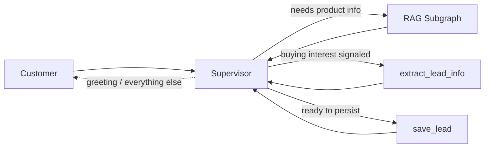
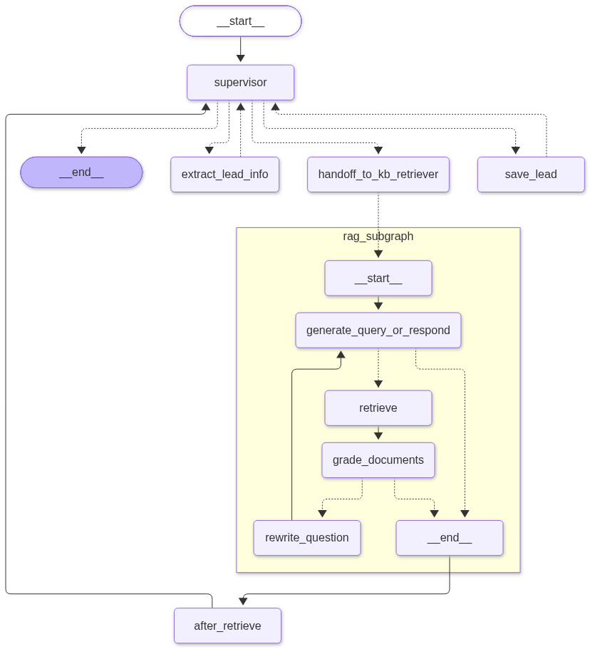

# InsureX Sales Agent — Agentic RAG + Lead Collection

Built for an **InsureX Data/AI Staff take-home assessment**. A LangGraph
**Supervisor** agent answers customer questions about InsureX insurance
products via agentic RAG, and — when a customer signals buying interest —
extracts and persists their contact details as a sales lead, all while
keeping each customer's conversation isolated and remembered across turns.

- **Agents**: LangGraph (single `supervisor` node, `Command(goto=...)` routing — not a classic
  supervisor/handoff multi-agent split; see [Architecture notes](#architecture-notes) for why)
- **RAG**: agentic retrieve → grade → rewrite loop (ChromaDB + OpenAI embeddings) over 5
  self-authored Thai insurance PDFs
- **API**: FastAPI, streaming responses over SSE
- **LLM**: OpenAI or Azure OpenAI (`gpt-4o-mini` by default), configurable
- **Memory**: SQLite-checkpointed conversations (per-`session_id` isolation) + context
  trim/summarize for long conversations
- **Leads**: a plain LangChain tool (not an MCP server — see
  [Scope departures](#scope-departures)) extracts and persists customer lead data to SQLite,
  gated behind a two-step completeness + explicit-confirmation check

## Project layout

```
agents/
├── orchestrator.py        # Top-level StateGraph: supervisor + 3 tool nodes + rag_subgraph (defines, doesn't run)
├── runner.py                # Executes the graph: astream_turn(), stream_events() for the SSE endpoint
├── llm.py                     # LLM client factory (OpenAI/Azure switch)
├── state.py                     # GraphState + RetrieverState (TypedDicts), the add_trace reducer
├── tools.py                       # extract_lead_info, save_lead, handoff_to_kb_retriever
├── memory.py                        # sanitize_dangling_tool_calls() + trim/summarize context management
├── trace.py                           # render_dialogue() — human-readable replay log
├── logging_conf.py                      # Structured JSON stdout logging
├── visualize.py                           # get_graph(xray=True).draw_mermaid_png() — regenerate graph.png
├── prompts/
│   ├── _supervisor.md                       # The one prompt: tool-use rules, confirmation gate, honesty rule
│   ├── _extract_lead.md                       # extract_lead_info's own prompt
│   └── _grade_rewrite.py                        # Grade/rewrite templates for the RAG subgraph
└── subgraphs/
    └── rag.py                                     # Agentic RAG: generate_query_or_respond, retrieve, grade, rewrite
api/
├── main.py                 # FastAPI app, one router
├── routes/chat.py            # POST /chat — thin, hands off to agents.runner.stream_events
└── schemas/chat.py             # SessionChatRequest{message, session_id}
eval/
├── golden_dataset.json     # 13 qa_cases + 6 lead_cases + 2 session_cases
├── metrics.py                 # Hit Rate@k, MRR — standard IR metrics, no new dependency
├── run_full_eval.py             # Runs the full 21-case suite, writes demo_log.txt
└── demo_log.txt                   # Full transcripts + pass/fail — THE demo/test-case deliverable
Data/pdfs/                 # 5 synthetic Thai knowledge-base PDFs (see Scope departures)
db/                        # gitignored: leads.sqlite, checkpoints.sqlite (created on first run)
tests/test_graph_smoke.py  # One assert-based smoke test
graph.png                  # Native LangGraph render of the real graph structure
```

## Architecture overview



`supervisor` is the **only** node that ever composes a user-facing reply, on
every path — qa answers, lead acknowledgements, and plain conversation all
go through it. This is a deliberate departure from a classic multi-agent
supervisor/handoff split; see [Architecture notes](#architecture-notes).

### The real graph



Generated directly from the compiled graph — `python -m agents.visualize`
(`get_graph(xray=True).draw_mermaid_png()`). Regenerate after any node/edge
change. Each tool (`extract_lead_info`, `save_lead`, `handoff_to_kb_retriever`)
is its own graph node, not a single shared dispatcher — the diagram shows the
real `Command(goto=...)` routing for each one, declared via
`add_node(..., destinations=...)` render-only metadata.

---

## 1. Supervisor (`agents/orchestrator.py`)

| Node | What it does |
|---|---|
| `supervisor` | The only reply-composing node. Loop guard first (`GRAPH_MAX_STEPS`, resets on every fresh customer message — not accumulated across turns). Repairs any dangling tool call from a prior crash/disconnect (`sanitize_dangling_tool_calls`), then trims + summarizes the conversation if it's grown past `CONTEXT_TOKEN_THRESHOLD`. Calls the LLM bound with all 3 tools. |
| `handoff_to_kb_retriever` | `ToolNode([handoff_to_kb_retriever])`. The tool itself returns `Command(goto="rag_subgraph", ...)`. |
| `extract_lead_info` | `ToolNode([extract_lead_info])`. Reads the conversation via `InjectedState` (never a `supervisor`-paraphrased argument), runs its own structured-output LLM call, returns `Command(goto="supervisor", ...)`. |
| `save_lead` | `ToolNode([save_lead])`. Completeness + confirmation gate (below), persists to SQLite, returns `Command(goto="supervisor", ...)`. |
| `rag_subgraph` | The RAG agent's entire compiled graph, embedded directly as this node — see [§2](#2-rag-subgraph). |
| `after_retrieve` | Bridge node, outside the subgraph: turns `state["snippets"]` into a summary note `supervisor` can see, and — if the final retrieval attempt was graded irrelevant — prefixes it with a `⚠️` warning (see [No hallucinated certainty](#no-hallucinated-certainty)). |

## 2. RAG subgraph (`agents/subgraphs/rag.py`)

The agentic RAG pattern: retrieve, grade relevance against the *original*
question, and rewrite-and-retry if the result wasn't actually relevant,
instead of a single fire-and-forget similarity search.

| Node | What it does |
|---|---|
| `generate_query_or_respond` | Calls the LLM bound with the `retrieve_knowledge_base` tool. |
| `retrieve` | Runs the tool: vector search over ChromaDB (`text-embedding-3-large`, `RETRIEVER_TOP_K`=2), tags each chunk `[source.pdf]`. |
| `grade_documents` | Structured-output LLM call (`GradeDocuments`, binary `yes`/`no`) checks whether the retrieved chunks answer the *original* question — not the (possibly rewritten) search query. |
| `rewrite_question` | Rewrites the query for a better attempt, increments the retry counter, loops back — capped at `RETRIEVER_MAX_REWRITES` (default 2). |

**Chunking**: `RecursiveCharacterTextSplitter` (`CHUNK_SIZE`=500,
`CHUNK_OVERLAP`=50). **Persisted** vector store in `chroma_db/` (gitignored,
built from `Data/pdfs/*.pdf` via `pypdf` directly — no `langchain-community`
dependency needed just for `PyPDFLoader`).

## 3. Lead collection (`agents/tools.py`)

Two tools, bound alongside `handoff_to_kb_retriever` on the same `supervisor`:

- **`extract_lead_info()`** — no arguments from `supervisor` at all. Reads
  the conversation directly via `InjectedState` and reports what's actually
  been said (name, occupation, income, phone, interested product, inquiry
  summary) — leaving a field blank rather than guessing.
- **`save_lead(...)`** — two separate, deterministic gates, not one:
  1. **Completeness**: all 4 required fields (name, occupation, income,
     phone) must be present and non-blank, or it returns `"Missing: X"`.
  2. **Confirmation**: even with all 4 fields present, it will **not**
     persist on the first call — it returns `"Data complete but not yet
     confirmed"` and asks `supervisor` to restate the values and get an
     explicit "yes" first. Only `confirmed=True` on a *later* call persists.

  Every field is `Optional` — including the 4 the brief requires — on
  purpose: a *required* tool argument pressures the model to fabricate a
  value it doesn't have. The blank-aware completeness check inside the tool
  body is the real, deterministic gate instead.

Persisted to `db/leads.sqlite` (`session_id`, name/occupation/income/phone,
`interested_product`/`inquiry_summary` — both nullable, best-effort,
`conversation_log` — a `render_dialogue(trace)` snapshot taken at save time).
`session_id` doubles as the `thread_id` into `checkpoints.sqlite`, so a human
operator can look up the full exact conversation later without a second
logging system.

---

## Important implementation details

### Step-by-step trace ("thinking")
Every node that narrates a decision or result appends a line to
`state["trace"]` (a custom `add_trace` reducer — see
[Command-routing caveats](#command-routing-caveats) for why it isn't plain
`operator.add`). `agents/trace.py`'s `render_dialogue(trace)` turns it into a
readable transcript:

```
Supervisor: ต้องการข้อมูลเกี่ยวกับแผนประกัน Health Plus → ค้นข้อมูลในฐานความรู้
RAG Agent: ค้นข้อมูลด้วยคำค้น "Health Plus แผนประกัน"
RAG Agent: ค้นพบ 2 ข้อความจากฐานความรู้
RAG Agent (ตรวจสอบ): ข้อมูลที่ได้เกี่ยวข้องเพียงพอ ✅
Supervisor: ประกันสุขภาพ InsureX Health Plus มีแผนหลัก ๆ ดังนี้...
```

This log — not a separate ops database — **is** the project's "Demo/Test
Case" deliverable: see [`eval/demo_log.txt`](eval/demo_log.txt), regenerated
by `python -m eval.run_full_eval`.

### Context management
- **Trimming**: once `supervisor`'s conversation exceeds
  `CONTEXT_TOKEN_THRESHOLD` (2000 tokens, approximate), `trim_messages
  (strategy="last", start_on="human")` keeps the most recent
  `CONTEXT_KEEP_TOKENS` (800) verbatim.
- **Summarization**: the trimmed-off *older* messages aren't discarded — an
  LLM merges them into the **existing** `conversation_summary` (never
  re-summarizes from scratch, which would silently drop whatever an earlier
  trim already compressed), folded into the next LLM call as a second
  `SystemMessage`.
- **This is a mastery-demonstration addition, not a scale necessity** — this
  demo's conversations are short-lived and would never actually hit the
  threshold. Re-added deliberately to show the pattern for this assessment;
  say so plainly rather than implying it was load-bearing here.

### Session management
`session_id` is supplied by the caller and used directly as LangGraph's
`thread_id`. Persisted via `AsyncSqliteSaver` at `db/checkpoints.sqlite` —
survives a server restart, and **genuinely isolates** two customers'
conversations (verified directly: a second session has zero knowledge of the
first's data, confirmed both by the reply content and by querying
`checkpoints.sqlite` for distinct `thread_id` rows — not just "seemed to work
in one demo session").

### Command-routing caveats
Two real, empirically-confirmed LangGraph behaviors this project is built
around, not assumed:

1. **A static edge out of a `Command`-returning tool's node fires *in
   addition to* that `Command`'s own `goto`** — not instead of it, even when
   they target different nodes. Confirmed by a duplicated trace line during
   development, traced to `supervisor` running an extra time before the RAG
   subgraph ever got control. **Fix**: no static edge exists anywhere in this
   graph out of a tool node — every tool sets `Command(goto=...)` explicitly.
2. **Sharing an accumulator field by name across a parent/subgraph
   boundary double-merges it** — the subgraph's own final cumulative `trace`
   gets merged into the parent a second time, on top of lines already
   propagated incrementally. `query`/`snippets`/`last_retrieval_relevant`
   don't show this because they're plain overwrite fields, not
   reducer-accumulated. `add_trace` (`agents/state.py`) finds the real
   overlap and appends only the genuinely new suffix instead of using plain
   `operator.add`.

### No hallucinated certainty
`grade_documents`' final verdict (`last_retrieval_relevant`) is shared with
the parent graph specifically so `supervisor` can tell the difference between
"here's what I found" and "retries ran out and this still wasn't graded
relevant." Without this, a real failure mode was found during evaluation:
`supervisor` stated a **specific, confident, wrong number** pulled from
snippets that had just been graded irrelevant. Now, any note prefixed `⚠️`
comes with an explicit instruction: never state a specific number or
condition from it, say "ไม่พบข้อมูลที่ชัดเจน" (no clear information found)
instead. Fixed, re-verified across the full 21-case suite afterward with zero
regressions on previously-passing cases, and it generalized to multiple other
cases, not just the one it was originally built for.

### Streaming (SSE)
Real per-token streaming — `stream_mode=["messages", "updates"],
subgraphs=True` (required: without `subgraphs=True`, LLM calls running
*inside* `rag_subgraph` silently emit zero token chunks to the parent
stream — not an edge case). Token frames are filtered to `namespace == ()`
so only `supervisor`'s own reply streams to the client — confirmed
empirically that without this filter, the RAG subgraph's internal
`grade_documents` call leaks its raw structured-output JSON into the token
stream.

| event | when |
|---|---|
| `status` | A tool is about to run — `{"stage": "working", "tool": "<name>"}` |
| `token` | A chunk of `supervisor`'s own reply |
| `done` | Always sent (`finally:` block) — carries `session_id` |

**Disconnect cancellation**: verified directly against the installed
`starlette`/`fastapi`/`uvicorn` versions (not assumed) — the graph runs
inline inside the SSE generator (never a detached background task), and a
real forced client disconnect was confirmed, via an instrumented test, to
raise `CancelledError` into the running graph at the moment of disconnect —
genuinely saves the in-flight LLM cost, not just in theory.

---

## API reference

Full interactive docs at `/docs` (Swagger) once running.

**`POST /chat`**

```json
// Request
{ "message": "Health Plus มีแผนอะไรบ้าง", "session_id": "any-string-you-pick" }

// Response — text/event-stream
event: status
data: {"stage": "working", "tool": "handoff_to_kb_retriever"}

data: {"type": "token", "content": "ประ"}
data: {"type": "token", "content": "กัน"}
data: {"type": "token", "content": "สุข"}
...

event: done
data: {"session_id": "any-string-you-pick"}
```

---

## Demo transcripts

Full run: [`eval/demo_log.txt`](eval/demo_log.txt) (21 cases, regenerate with
`python -m eval.run_full_eval`). A representative sample below, trimmed with
`...` where a reply repeats a pattern already shown — the linked file has
every case in full, untrimmed.

<details>
<summary><b>qa-01</b> — easy, single-doc retrieval (PASS)</summary>

```
Query: InsureX Health Plus มีแผนอะไรบ้าง และวงเงินคุ้มครองเท่าไหร่?

Supervisor: ต้องการข้อมูลเกี่ยวกับแผนและวงเงินคุ้มครองของผลิตภัณฑ์ InsureX Health Plus → ค้นข้อมูลในฐานความรู้
RAG Agent: ค้นข้อมูลด้วยคำค้น "InsureX Health Plus แผนและวงเงินคุ้มครอง"
RAG Agent: ค้นพบ 2 ข้อความจากฐานความรู้
RAG Agent (ตรวจสอบ): ข้อมูลที่ได้เกี่ยวข้องเพียงพอ ✅
Supervisor: ผลิตภัณฑ์ InsureX Health Plus มีแผนประกันสุขภาพแบบเหมาจ่ายต่อปี โดยมีรายละเอียดดังนี้:

1. **แผน Bronze**: วงเงินคุ้มครอง 500,000 บาท
   - อายุ 0-20 ปี: เบี้ยประกัน 8,500 บาท
   - อายุ 21-40 ปี: เบี้ยประกัน 11,200 บาท
   - อายุ 41-60 ปี: เบี้ยประกัน 18,900 บาท
2. **แผน Silver**: วงเงินคุ้มครอง 1,000,000 บาท ...
3. **แผน Gold**: วงเงินคุ้มครอง 3,000,000 บาท ...

หากคุณต้องการข้อมูลเพิ่มเติมหรือมีคำถามอื่น ๆ สามารถสอบถามได้เลยค่ะ!
```
</details>

<details>
<summary><b>qa-06</b> — hard, rewrite loop exhausts without recovering (FAIL on exact keypoints, honest fallback)</summary>

```
Query: ลูกค้าท้องแล้วเคลมค่าคลอดได้ไหม

Supervisor: ต้องการข้อมูลเกี่ยวกับการเคลมค่าคลอดในประกัน → ค้นข้อมูลในฐานความรู้
RAG Agent: ค้นข้อมูลด้วยคำค้น "เคลมค่าคลอด"
RAG Agent: ค้นพบ 2 ข้อความจากฐานความรู้
RAG Agent (ตรวจสอบ): ข้อมูลที่ได้ไม่เกี่ยวข้องเพียงพอ ❌ — ลองใหม่ (1/2)
RAG Agent: เขียนคำถามใหม่เป็น "ลูกค้าที่ตั้งครรภ์สามารถขอเคลมค่าคลอดจากประกันสุขภาพได้หรือไม่?"
RAG Agent: ค้นข้อมูลด้วยคำค้น "ประกันสุขภาพค่าคลอด"
RAG Agent: ค้นพบ 2 ข้อความจากฐานความรู้
RAG Agent (ตรวจสอบ): ข้อมูลที่ได้ไม่เกี่ยวข้องเพียงพอ ❌ — ลองใหม่ (2/2)
RAG Agent: เขียนคำถามใหม่เป็น "ลูกค้าที่ตั้งครรภ์สามารถขอเคลมค่าคลอดจากประกันสุขภาพได้หรือไม่?"
RAG Agent: ค้นข้อมูลด้วยคำค้น "ประกันสุขภาพค่าคลอดสำหรับผู้ตั้งครรภ์"
RAG Agent: ค้นพบ 2 ข้อความจากฐานความรู้
RAG Agent (ตรวจสอบ): ข้อมูลที่ได้ไม่เกี่ยวข้องเพียงพอ ❌ — ลองใหม่ (2/2)
Supervisor: ไม่พบข้อมูลที่ชัดเจนเกี่ยวกับการเคลมค่าคลอดในประกัน หากต้องการข้อมูลที่แน่นอน
แนะนำให้ติดต่อเจ้าหน้าที่ของ InsureX เพื่อสอบถามรายละเอียดเพิ่มเติมเกี่ยวกับเงื่อนไขการเคลมค่าคลอดค่ะ
```

The loop genuinely runs to its full retry budget and never finds the "ข้อยกเว้น"
(exclusion) framing the source document actually uses — ends in an honest
fallback, not a hallucinated guess. See [Known limitations](#known-limitations).
</details>

<details>
<summary><b>qa-13</b> — small talk, zero tool calls (PASS)</summary>

```
Query: สวัสดีครับ

Supervisor: สวัสดีครับ! มีอะไรให้ช่วยเหลือเกี่ยวกับประกันหรือผลิตภัณฑ์ของ InsureX ไหมครับ?
```

The only case where `handoff_to_kb_retriever` is never called at all — verified
by asserting no `"RAG Agent"` trace line appears.
</details>

<details>
<summary><b>lead-01</b> — complete info, confirmation gate blocks the first save (PASS)</summary>

```
turn 1: สวัสดีค่ะ หนูชื่อสมหญิง ใจดี อาชีพพยาบาล เงินเดือนประมาณ 35,000 บาท สนใจแผน Health Plus Silver ค่ะ เบอร์โทรติดต่อ 089-123-4567
turn 2: ใช่ค่ะ ถูกต้องแล้ว

Lead Saver: Data complete but not yet confirmed (name=สมหญิง ใจดี, occupation=พยาบาล, income=35,000 บาท, phone=089-123-4567). Restate these exact values to the customer and ask them to confirm before calling save_lead again with confirmed=True.
Supervisor: ขอบคุณค่ะ คุณสมหญิง ใจดี ข้อมูลที่เราได้รับคือ: ... กรุณายืนยันข้อมูลเหล่านี้ให้ถูกต้องก่อนที่เราจะดำเนินการต่อค่ะ
Lead Saver: Lead saved (id=1)
Supervisor: ขอบคุณค่ะ คุณสมหญิง ใจดี ข้อมูลของคุณได้ถูกบันทึกเรียบร้อยแล้ว หากมีคำถามเพิ่มเติม...

DB row: ('สมหญิง ใจดี', 'พยาบาล', '35,000 บาท', '089-123-4567', 'Health Plus Silver')
```

Note: `save_lead` was called directly with all fields already present from the
raw message — `extract_lead_info` wasn't invoked first this turn (the model
sometimes composes the arguments itself instead, a known, honestly-documented
prompt-adherence gap, not a code bug — the completeness/confirmation gates still
hold either way).
</details>

<details>
<summary><b>lead-05</b> — multi-turn completion, no re-trigger phrase needed (PASS)</summary>

```
turn 1: ผมชื่อประยุทธ ทำงานขับแท็กซี่ เงินเดือนประมาณ 20,000 สนใจ Life Secure ครับ
turn 2: 089-999-8888
turn 3: ถูกต้องครับ

Lead Extractor: {"name":"ประยุทธ","occupation":"ขับแท็กซี่","income":"20,000","phone":null,"interested_product":"Life Secure",...}
Supervisor: คุณประยุทธ ขับแท็กซี่ รายได้ประมาณ 20,000 บาท สนใจผลิตภัณฑ์ Life Secure ครับ ขอเบอร์โทรศัพท์ติดต่อกลับหน่อยครับ
Lead Saver: Data complete but not yet confirmed (...)
Supervisor: ข้อมูลที่เรามีคือ: ... กรุณายืนยันข้อมูลเหล่านี้ให้ถูกต้องก่อนที่เราจะดำเนินการต่อครับ
Lead Saver: Lead saved (id=2)
Supervisor: ข้อมูลของคุณประยุทธได้ถูกบันทึกเรียบร้อยแล้วครับ ...

DB row: ('ประยุทธ', 'ขับแท็กซี่', '20,000', '089-999-8888', 'Life Secure')
```

Turn 2 is just a phone number — no "สนใจ" (interested) phrase repeated. Proves
the continuation instruction in `_supervisor.md` works: there's no code-level
entry-check left to fall back on, this is pure prompt-level reasoning.
</details>

<details>
<summary><b>lead-06</b> — correction, not confirmation; must not be waved through (PASS, Data Integrity)</summary>

```
turn 1: ผมชื่อสมชาย ทำงานช่างไฟฟ้า เงินเดือน 25,000 สนใจ Health Plus ครับ เบอร์ 089-111-2222
turn 2: เบอร์ผิดครับ ที่จริงคือ 089-333-4444
turn 3: ใช่ครับ ถูกต้องแล้ว

Lead Extractor: {..."phone":"089-111-2222",...}
Lead Saver: Data complete but not yet confirmed (..., phone=089-111-2222). Restate...
Supervisor: ข้อมูลที่บันทึกไว้มีดังนี้: ... เบอร์โทร: 089-111-2222 ... กรุณายืนยัน...
Lead Extractor: {..."phone":"089-333-4444",...}
Supervisor: ข้อมูลที่บันทึกไว้มีการแก้ไขเบอร์โทรเป็นดังนี้: ... เบอร์โทร: 089-333-4444 ... กรุณายืนยัน...
Lead Saver: Lead saved (id=3)
Supervisor: ข้อมูลของคุณสมชายได้ถูกบันทึกเรียบร้อยแล้วครับ ...

DB row: ('สมชาย', 'ช่างไฟฟ้า', '25,000', '089-333-4444', 'Health Plus')
```

Turn 2's correction was **not** misread as a confirmation — `supervisor`
re-extracted, re-stated, and asked again, only saving on turn 3's genuine "yes."
The DB row holds the **corrected** phone number, not the original wrong one —
the one case with zero code-level fallback left to catch this, so a pass here
is a real, meaningful Data Integrity result.
</details>

<details>
<summary><b>session-01 / session-02</b> — isolation and recall (both PASS)</summary>

```
[session-01: context_isolation]
[sess-A] USER: หนูชื่อสมหญิง สนใจ Health Plus ค่ะ
[sess-A] REPLY: คุณสมหญิง สนใจผลิตภัณฑ์ Health Plus ค่ะ ขอข้อมูลเพิ่มเติม...
[sess-B] USER: ชื่อฉันคืออะไร
[sess-B] REPLY: ขอโทษครับ ฉันไม่สามารถบอกชื่อของคุณได้ในตอนนี้ คุณสามารถบอกชื่อ...

[session-02: memory_recall_same_session]
[sess-C] USER: Health Plus มีแผนอะไรบ้าง
[sess-C] REPLY: ... แผน Bronze (วงเงิน 500,000 บาท) ... แผน Silver ... แผน Gold ...
[sess-C] USER: แผนที่ถูกที่สุดคืออะไร
[sess-C] REPLY: แผนที่ถูกที่สุดของประกันสุขภาพ InsureX Health Plus คือ แผน Bronze
ซึ่งมีวงเงินคุ้มครอง 500,000 บาท โดยเบี้ยประกัน... 8,500 บาท ...
```

`sess-B` has zero knowledge of `sess-A`'s "สมหญิง" (different `thread_id`,
verified directly against `checkpoints.sqlite` too, not just the reply text).
`sess-C`'s second turn correctly resolves "ถูกที่สุด" (cheapest) against
Health Plus from turn 1 in the *same* thread.
</details>

---

## Installation & running

```bash
# 1. Create and activate a virtual environment
python -m venv .venv
.venv\Scripts\activate        # Windows
# source .venv/bin/activate   # macOS/Linux

# 2. Install dependencies
pip install -r requirements.txt

# 3. Configure environment
cp .env.example .env
# fill in OPENAI_API_KEY (or the Azure block + LLM_PROVIDER=azure)

# 4. Run the API
uvicorn api.main:app --reload
# -> http://127.0.0.1:8000/docs

# 5. Run the full evaluation suite (regenerates eval/demo_log.txt)
python -m eval.run_full_eval
```

### Testing the API directly

```bash
curl -N -X POST http://127.0.0.1:8000/chat \
  -H "Content-Type: application/json" \
  -d '{"message": "Health Plus มีแผนอะไรบ้าง", "session_id": "test-1"}'
```

> On Windows/Git Bash specifically: pass Thai text via `--data-binary @file.json`
> rather than an inline `-d '...'` — found the hard way that inline `-d` mangles
> non-ASCII text under Git Bash's quoting, which looks identical to a real API
> bug (`400: There was an error parsing the body`) until you isolate it.

---

## Scope departures

Stated plainly rather than hoping they go unnoticed:

1. **MCP not implemented.** `save_lead`/`extract_lead_info` are plain
   LangChain `@tool`s, not an MCP server — gives up part of Bonus Task 1's
   literal protocol requirement. The data-extraction-and-persistence
   *behavior* the brief actually asks for is fully implemented; only the
   transport/protocol wrapper is not.
2. **Context trim + merge-summarize is a mastery-demonstration addition, not
   a scale necessity** for this demo's short conversations — see
   [Context management](#context-management).
3. **`supervisor` composes every final reply itself**, on every path — the
   literal thing a classic supervisor/handoff pattern says not to do (a
   supervisor should route, specialists should answer). Accepted
   deliberately: it resolves an asymmetry an earlier design draft had (qa
   answers came from one node, lead acknowledgements from another) by making
   every path answer the same way, at the cost of the pattern's usual
   separation of concerns.
4. **A served FastAPI + SSE endpoint, built even though the brief's stated
   deliverable is repo + README + demo log, not a running service.** Scoped
   down hard from a full multi-tenant reference it was checked against — no
   auth, no CORS, no ownership/multi-user concept, no cost-tracking history.
5. **The 5 knowledge-base PDFs are self-authored placeholder data**
   ([`Data/pdfs/`](Data/pdfs/)) — InsureX didn't provide real product
   documents, so 5 synthetic Thai documents were written for a fictional
   "InsureX" product line (product overview, premium/coverage table, claims
   FAQ, policy terms & exclusions, riders/add-ons) to have something
   realistic for the RAG pipeline to search.

## Known limitations

Reported honestly from the full evaluation run
([`eval/demo_log.txt`](eval/demo_log.txt)), not smoothed over:

- **16/21 golden cases pass** on a strict keypoint-substring check; Hit
  Rate@k = 0.91, MRR = 0.86 over the 11 qa cases with a known source
  document. All 6 lead cases and both session cases pass cleanly.
- Several of the "failures" are checker artifacts, not agent bugs — correct,
  grounded answers that just don't repeat the dataset's exact wording (e.g.
  giving the right premium figure without restating the literal age-bracket
  label).
- **One real, unexplained regression**: a hard case (`qa-06`, rewrite-loop
  exercise) sometimes skips retrieval entirely and asks a clarifying
  question instead — reproduced on an isolated rerun, not a one-off fluke,
  but not root-caused. Likely prompt-sensitivity from `_supervisor.md`
  growing across phases; stated honestly as unexplained rather than
  guessed at.
- **Multi-hop retrieval is a genuine, demonstrated limit**: a question
  needing facts from 2 documents (`qa-12`) never retrieves the first one,
  within one shared rewrite-loop budget. The *dangerous* failure mode this
  produced — a confident, specific, wrong answer — is fixed (see
  [No hallucinated certainty](#no-hallucinated-certainty)); the underlying
  retrieval miss is not.

## Architecture notes

This project's design was developed against a set of reusable multi-agent
architecture patterns distilled from a prior production system (not included
in this deliverable). Several deliberate departures from that reference
pattern are named throughout this README and documented inline as comments in
`agents/*.py` — e.g. the "no static edge out of a tool node" and
`add_trace`'s overlap-aware reducer, both in [Command-routing
caveats](#command-routing-caveats), explain themselves at the point of use in
the source rather than requiring an external design document.
