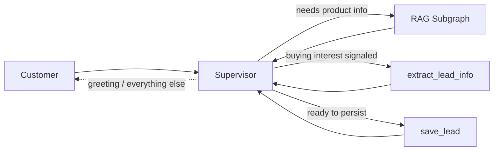
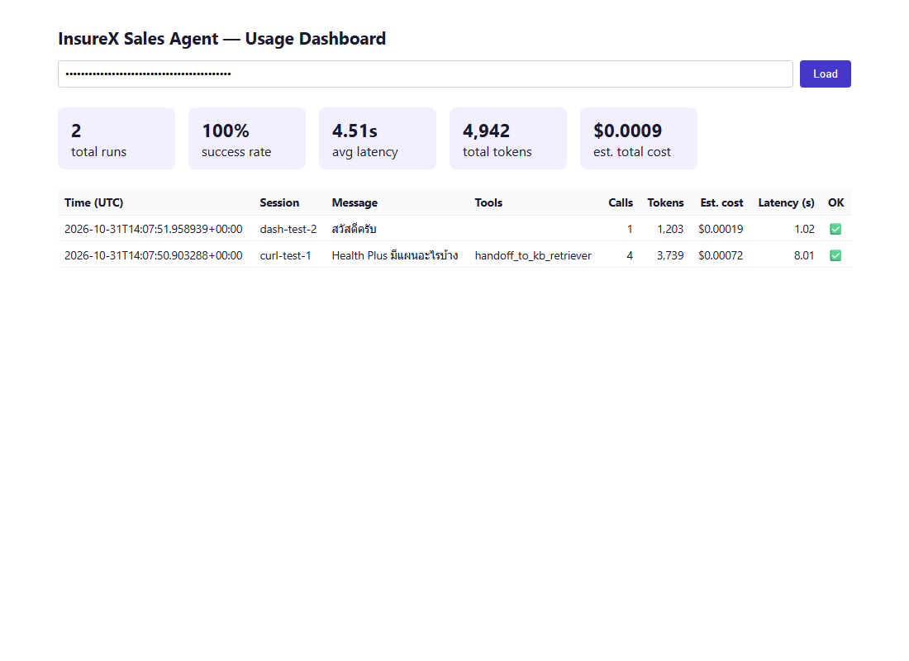
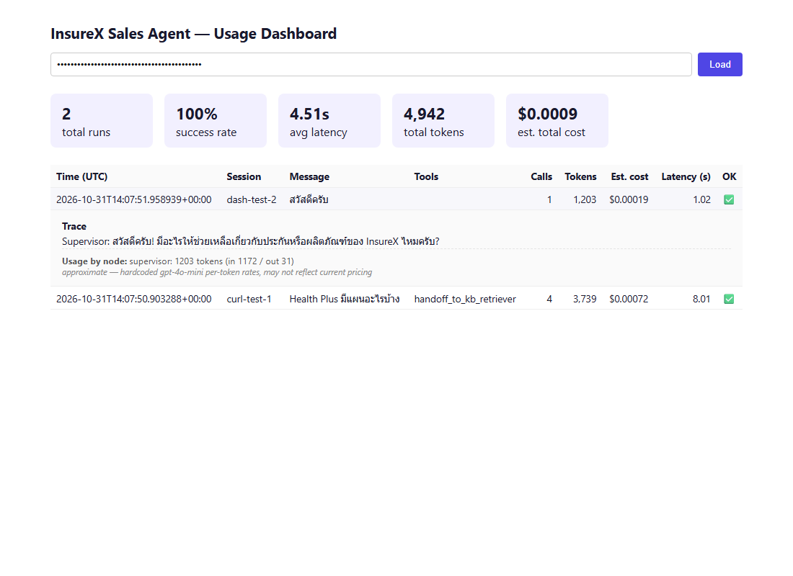
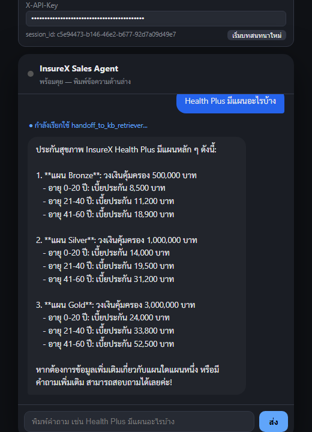

# InsureX Sales Agent — Agentic RAG + Lead Collection

Built for an **InsureX Data/AI Staff take-home assessment**. A LangGraph
**Supervisor** agent answers customer questions about InsureX insurance
products via agentic RAG, and — when a customer signals buying interest —
extracts and persists their contact details as a sales lead, all while
keeping each customer's conversation isolated and remembered across turns.

- **Agents**: LangGraph (single `supervisor` node, `Command(goto=...)` routing)
- **RAG**: agentic retrieve → grade → rewrite loop (ChromaDB + OpenAI embeddings) over 5
  self-authored Thai insurance PDFs
- **API**: FastAPI, streaming responses over SSE
- **LLM**: OpenAI or Azure OpenAI (`gpt-4o-mini` by default), configurable
- **Memory**: SQLite-checkpointed conversations (per-`session_id` isolation) + context
  trim/summarize for long conversations
- **Leads**: a plain LangChain tool (not an MCP server) extracts and persists customer lead
  data to SQLite, gated behind a two-step completeness + explicit-confirmation check

## Project layout

```
agents/
├── orchestrator.py        # Top-level StateGraph: supervisor + 3 tool nodes + rag_subgraph (defines, doesn't run)
├── runner.py                # Executes the graph: astream_turn(), stream_events() for the SSE endpoint
├── llm.py                     # LLM client factory (OpenAI/Azure switch)
├── state.py                     # GraphState + RetrieverState (TypedDicts), the add_trace reducer
├── tools.py                       # extract_lead_info, save_lead, handoff_to_kb_retriever
├── memory.py                        # sanitize_dangling_tool_calls() + trim/summarize context management
├── trace.py                           # render_dialogue() — human-readable replay log
├── logging_conf.py                      # Structured JSON stdout logging
├── visualize.py                           # get_graph(xray=True).draw_mermaid_png() — regenerate assets/graph.png
├── prompts/
│   ├── _supervisor.md                       # The one prompt: tool-use rules, confirmation gate, honesty rule
│   ├── _extract_lead.md                       # extract_lead_info's own prompt
│   └── _grade_rewrite.py                        # Grade/rewrite templates for the RAG subgraph
└── subgraphs/
    └── rag.py                                     # Agentic RAG: generate_query_or_respond, retrieve, grade, rewrite
api/
├── main.py                 # FastAPI app, lifespan (one shared checkpointer), error handlers
├── auth.py                   # require_api_key — X-API-Key via fastapi.security.APIKeyHeader
├── routes/                     # chat.py, runs.py — thin, hand off to agents.runner
└── schemas/                      # chat.py, runs.py, leads.py, error.py — request/response/error models
eval/
├── golden_dataset.json     # 13 qa_cases + 6 lead_cases + 2 session_cases
├── metrics.py                 # Hit Rate@k, MRR — standard IR metrics, no new dependency
├── judge.py                      # LLM-as-judge: is the reply grounded in what was retrieved?
├── run_full_eval.py                # Runs the full 21-case suite, writes demo_log.txt
└── demo_log.txt                      # Full transcripts + pass/fail — THE demo/test-case deliverable
Data/pdfs/                 # 5 synthetic Thai knowledge-base PDFs (self-authored, InsureX didn't provide real ones)
db/                        # gitignored: leads.sqlite, checkpoints.sqlite (created on first run)
tests/test_graph_smoke.py  # One assert-based smoke test
assets/                    # Screenshots + the graph render, used by this README
streamlit_app.py           # Chat UI deployable standalone to Streamlit Cloud (runs the agent in-process)
```

## Architecture overview



`supervisor` is the **only** node that ever composes a user-facing reply, on
every path — qa answers, lead acknowledgements, and plain conversation all
go through it.

### The real graph


Generated directly from the compiled graph — `python -m agents.visualize`
(`get_graph(xray=True).draw_mermaid_png()`). Regenerate after any node/edge
change. Each tool (`extract_lead_info`, `save_lead`, `handoff_to_kb_retriever`)
is its own graph node, not a single shared dispatcher — the diagram shows the
real `Command(goto=...)` routing for each one, declared via
`add_node(..., destinations=...)` render-only metadata.

---

## 1. Supervisor (`agents/orchestrator.py`)

| Node | What it does |
|---|---|
| `supervisor` | The only reply-composing node. Loop guard first (`GRAPH_MAX_STEPS`, resets on every fresh customer message — not accumulated across turns). Repairs any dangling tool call from a prior crash/disconnect (`sanitize_dangling_tool_calls`), then trims + summarizes the conversation if it's grown past `CONTEXT_TOKEN_THRESHOLD`. Calls the LLM bound with all 3 tools. |
| `handoff_to_kb_retriever` | `ToolNode([handoff_to_kb_retriever])`. The tool itself returns `Command(goto="rag_subgraph", ...)`. |
| `extract_lead_info` | `ToolNode([extract_lead_info])`. Reads the conversation via `InjectedState` (never a `supervisor`-paraphrased argument), runs its own structured-output LLM call, returns `Command(goto="supervisor", ...)`. |
| `save_lead` | `ToolNode([save_lead])`. Completeness + confirmation gate (below), persists to SQLite, returns `Command(goto="supervisor", ...)`. |
| `rag_subgraph` | The RAG agent's entire compiled graph, embedded directly as this node — see [§2](#2-rag-subgraph). |
| `after_retrieve` | Bridge node, outside the subgraph: turns `state["snippets"]` into a summary note `supervisor` can see, and — if the final retrieval attempt was graded irrelevant — prefixes it with a `⚠️` warning (see [No hallucinated certainty](#no-hallucinated-certainty)). |

## 2. RAG subgraph (`agents/subgraphs/rag.py`)

The agentic RAG pattern: retrieve, grade relevance against the *original*
question, and rewrite-and-retry if the result wasn't actually relevant,
instead of a single fire-and-forget similarity search.

| Node | What it does |
|---|---|
| `generate_query_or_respond` | Calls the LLM bound with the `retrieve_knowledge_base` tool. |
| `retrieve` | Runs the tool: vector search over ChromaDB (`text-embedding-3-large`, `RETRIEVER_TOP_K`=2), tags each chunk `[source.pdf]`. |
| `grade_documents` | Structured-output LLM call (`GradeDocuments`, binary `yes`/`no`) checks whether the retrieved chunks answer the *original* question — not the (possibly rewritten) search query. |
| `rewrite_question` | Rewrites the query for a better attempt, increments the retry counter, loops back — capped at `RETRIEVER_MAX_REWRITES` (default 2). |

**Chunking**: `RecursiveCharacterTextSplitter` (`CHUNK_SIZE`=500,
`CHUNK_OVERLAP`=50). **Persisted** vector store in `chroma_db/` (gitignored,
built from `Data/pdfs/*.pdf` via `pypdf` directly — no `langchain-community`
dependency needed just for `PyPDFLoader`).

## 3. Lead collection (`agents/tools.py`)

Two tools, bound alongside `handoff_to_kb_retriever` on the same `supervisor`:

- **`extract_lead_info()`** — no arguments from `supervisor` at all. Reads
  the conversation directly via `InjectedState` and reports what's actually
  been said (name, occupation, income, phone, interested product, inquiry
  summary) — leaving a field blank rather than guessing.
- **`save_lead(...)`** — two separate, deterministic gates, not one:
  1. **Completeness**: all 4 required fields (name, occupation, income,
     phone) must be present and non-blank, or it returns `"Missing: X"`.
  2. **Confirmation**: even with all 4 fields present, it will **not**
     persist on the first call — it returns `"Data complete but not yet
     confirmed"` and asks `supervisor` to restate the values and get an
     explicit "yes" first. Only `confirmed=True` on a *later* call persists.

  Every field is `Optional` — including the 4 the brief requires — on
  purpose: a *required* tool argument pressures the model to fabricate a
  value it doesn't have. The blank-aware completeness check inside the tool
  body is the real, deterministic gate instead.

Persisted to `db/leads.sqlite` (`session_id`, name/occupation/income/phone,
`interested_product`/`inquiry_summary` — both nullable, best-effort,
`conversation_log` — a `render_dialogue(trace)` snapshot taken at save time).
`session_id` doubles as the `thread_id` into `checkpoints.sqlite`, so a human
operator can look up the full exact conversation later without a second
logging system.

---

## Important implementation details

### Step-by-step trace ("thinking")
Every node that narrates a decision or result appends a line to
`state["trace"]` (a custom `add_trace` reducer — see
[Command-routing caveats](#command-routing-caveats) for why it isn't plain
`operator.add`). `agents/trace.py`'s `render_dialogue(trace)` turns it into a
readable transcript:

```
Supervisor: ต้องการข้อมูลเกี่ยวกับแผนประกัน Health Plus → ค้นข้อมูลในฐานความรู้
RAG Agent: ค้นข้อมูลด้วยคำค้น "Health Plus แผนประกัน"
RAG Agent: ค้นพบ 2 ข้อความจากฐานความรู้
RAG Agent (ตรวจสอบ): ข้อมูลที่ได้เกี่ยวข้องเพียงพอ ✅
Supervisor: ประกันสุขภาพ InsureX Health Plus มีแผนหลัก ๆ ดังนี้...
```

This log — not a separate ops database — **is** the project's "Demo/Test
Case" deliverable: see [`eval/demo_log.txt`](eval/demo_log.txt), regenerated
by `python -m eval.run_full_eval`.

### Context management
- **Trimming**: once `supervisor`'s conversation exceeds
  `CONTEXT_TOKEN_THRESHOLD` (2000 tokens, approximate), `trim_messages
  (strategy="last", start_on="human")` keeps the most recent
  `CONTEXT_KEEP_TOKENS` (800) verbatim.
- **Summarization**: the trimmed-off *older* messages aren't discarded — an
  LLM merges them into the **existing** `conversation_summary` (never
  re-summarizes from scratch, which would silently drop whatever an earlier
  trim already compressed), folded into the next LLM call as a second
  `SystemMessage`.
- **This is a mastery-demonstration addition, not a scale necessity** — this
  demo's conversations are short-lived and would never actually hit the
  threshold. Re-added deliberately to show the pattern for this assessment;
  say so plainly rather than implying it was load-bearing here.

### Session management
`session_id` is supplied by the caller and used directly as LangGraph's
`thread_id`. Persisted via `AsyncSqliteSaver` at `db/checkpoints.sqlite` —
survives a server restart, and **genuinely isolates** two customers'
conversations (verified directly: a second session has zero knowledge of the
first's data, confirmed both by the reply content and by querying
`checkpoints.sqlite` for distinct `thread_id` rows — not just "seemed to work
in one demo session").

### Command-routing caveats
Two real, empirically-confirmed LangGraph behaviors this project is built
around, not assumed:

1. **A static edge out of a `Command`-returning tool's node fires *in
   addition to* that `Command`'s own `goto`** — not instead of it, even when
   they target different nodes. Confirmed by a duplicated trace line during
   development, traced to `supervisor` running an extra time before the RAG
   subgraph ever got control. **Fix**: no static edge exists anywhere in this
   graph out of a tool node — every tool sets `Command(goto=...)` explicitly.
2. **Sharing an accumulator field by name across a parent/subgraph
   boundary double-merges it** — the subgraph's own final cumulative `trace`
   gets merged into the parent a second time, on top of lines already
   propagated incrementally. `query`/`snippets`/`last_retrieval_relevant`
   don't show this because they're plain overwrite fields, not
   reducer-accumulated. `add_trace` (`agents/state.py`) finds the real
   overlap and appends only the genuinely new suffix instead of using plain
   `operator.add`.

### No hallucinated certainty
`grade_documents`' final verdict (`last_retrieval_relevant`) is shared with
the parent graph specifically so `supervisor` can tell the difference between
"here's what I found" and "retries ran out and this still wasn't graded
relevant." Without this, a real failure mode was found during evaluation:
`supervisor` stated a **specific, confident, wrong number** pulled from
snippets that had just been graded irrelevant. Now, any note prefixed `⚠️`
comes with an explicit instruction: never state a specific number or
condition from it, say "ไม่พบข้อมูลที่ชัดเจน" (no clear information found)
instead. Fixed, re-verified across the full 21-case suite afterward with zero
regressions on previously-passing cases, and it generalized to multiple other
cases, not just the one it was originally built for.

### Streaming (SSE)
Real per-token streaming — `stream_mode=["messages", "updates"],
subgraphs=True` (required: without `subgraphs=True`, LLM calls running
*inside* `rag_subgraph` silently emit zero token chunks to the parent
stream — not an edge case). Token frames are filtered to `namespace == ()`
so only `supervisor`'s own reply streams to the client — confirmed
empirically that without this filter, the RAG subgraph's internal
`grade_documents` call leaks its raw structured-output JSON into the token
stream.

| event | when |
|---|---|
| `status` | A tool is about to run — `{"stage": "working", "tool": "<name>"}` |
| `token` | A chunk of `supervisor`'s own reply |
| `done` | Always sent (`finally:` block) — carries `session_id` |

**Disconnect cancellation**: verified directly against the installed
`starlette`/`fastapi`/`uvicorn` versions (not assumed) — the graph runs
inline inside the SSE generator (never a detached background task), and a
real forced client disconnect was confirmed, via an instrumented test, to
raise `CancelledError` into the running graph at the moment of disconnect —
genuinely saves the in-flight LLM cost, not just in theory.

---

## API reference

Full interactive docs at `/api/v1/docs` (Swagger) once running — docs and every
real route live under `/api/v1`, including the two static pages, matching the
reference API's own convention. Only `GET /health` stays outside the version
prefix, same exception the reference makes: infra/monitoring checks shouldn't
need to track an API version. `/api/v1/chat` and `/api/v1/runs` require an
`X-API-Key` header (checked against the `API_KEY` env var, enforced once at
the router level, not per-route); `/api/v1/dashboard` and `/api/v1/chat-test`
stay public — they're static pages with no data baked in, a plain browser
navigation can't attach a custom header, so each asks for the key client-side
(kept in `sessionStorage` for the tab) and sends it as `X-API-Key` on its own
`/api/v1/runs` / `/api/v1/chat` fetches.

| Method | Path | Auth | Purpose |
|---|---|---|---|
| `GET` | `/health` | — (public) | Liveness check: graph compiled, API keys configured |
| `POST` | `/api/v1/chat` | `X-API-Key` | The chat endpoint (below) |
| `GET` | `/api/v1/chat/{session_id}` | `X-API-Key` | That session's chat history, `[{"role": "user"/"assistant", "content": ...}, ...]` — reads straight from the checkpointer, `[]` for an unused `session_id` |
| `GET` | `/api/v1/leads` | `X-API-Key` | Every customer lead saved so far (`db/leads.sqlite`, newest first) — who's shown buying interest |
| `GET` | `/api/v1/runs` | `X-API-Key` | JSON dump of `db/runs.jsonl` (newest first, capped to 500) — powers `/api/v1/dashboard` |
| `GET` | `/api/v1/dashboard` | — (public) | Usage dashboard: total runs, success rate, avg latency, a table of every run |
| `GET` | `/api/v1/chat-test` | — (public) | A live chat UI for manually testing `/api/v1/chat` (below) |

Every error response (4xx/5xx) has the same shape: `{"error": {"code": "...",
"message": "..."}}` — a global exception handler normalizes both `HTTPException`
and request-validation failures into it, rather than each raise site picking
its own ad hoc body.

**`POST /api/v1/chat`** — header `X-API-Key: <API_KEY>` required.

```json
// Request
{ "message": "Health Plus มีแผนอะไรบ้าง", "session_id": "any-string-you-pick" }

// Response — text/event-stream
event: status
data: {"stage": "working", "tool": "handoff_to_kb_retriever"}

data: {"type": "token", "content": "ประ"}
data: {"type": "token", "content": "กัน"}
data: {"type": "token", "content": "สุข"}
...

event: done
data: {"session_id": "any-string-you-pick"}
```

**`GET /api/v1/chat/{session_id}`** — header `X-API-Key: <API_KEY>` required.

```json
[
  { "role": "user", "content": "Health Plus มีแผนอะไรบ้าง" },
  { "role": "assistant", "content": "ประกันสุขภาพ InsureX Health Plus มีแผนหลัก ๆ ดังนี้: ..." }
]
```

Internal-only messages are filtered out — `extract_lead_info`/`save_lead`'s
raw tool results, and `after_retrieve_node`'s "Retrieved N snippet(s)"
bridge note, never appear here since a customer never saw either one either.

---

## Usage dashboard

`GET /api/v1/dashboard` — a single self-contained HTML page (`api/static/dashboard.html`,
vanilla JS, no build step, no new dependency), reading every logged run from
`GET /api/v1/runs`. Every `/api/v1/chat` call appends one record to `db/runs.jsonl`
(`agents/runner.py`'s `_log_run()`, best-effort — a logging failure never
breaks the actual chat response):

- `message` / `reply`, `tools_used`, `latency`, `success`/`error`
- `llm_calls` — how many separate LLM invocations that one turn made (e.g. a RAG
  turn: `generate_query_or_respond` → `grade_documents` → `supervisor` ×2)
- `usage` — `input_tokens`/`output_tokens`/`total_tokens`, both summed and broken
  down **per node** (`usage.by_node`), captured via `get_llm()`'s `stream_usage=True`
  from every LLM call in the turn — including ones inside `rag_subgraph` and inside
  a tool like `extract_lead_info`, not just supervisor's own call
- `estimated_cost_usd` — a rough estimate from a small hand-maintained price table
  (`agents/runner.py`'s `_PRICING_PER_1M_TOKENS`), **not fetched live** — treat it as
  approximate; `cost_note` on each record says so explicitly, and an unrecognized
  model gets `null` rather than a wrong guess
- `trace` — the full `render_dialogue()`-ready step-by-step trace (§3.8) for that
  turn, read straight from the checkpointer after the turn completes

Click a row to expand its trace and per-node usage breakdown. Enter your
`API_KEY` in the field at the top of the page to load the data — nothing
renders until a valid key is submitted, same gate as calling `/api/v1/runs` directly.




---

## Live chat test page

`GET /api/v1/chat-test` (`api/static/chat_test.html`) — a self-contained HTML page
for manually exercising `/api/v1/chat` from a browser, no backend framework
needed to view it: open it either via the running server (`http://localhost:8000/api/v1/chat-test`)
or directly as a local file (`file:///...` — the API has CORS enabled
specifically so this works cross-origin from a `file://` page, confirmed
necessary: without it the browser blocks the fetch before the request even
reaches the API key check).

Fill in the **Base URL** (defaults to `http://127.0.0.1:8000`) and your
**X-API-Key**, then chat — real token-by-token streaming via `fetch` +
`ReadableStream` (not `EventSource`, since sending a custom header on a POST
isn't possible with `EventSource`), with a live status line while a tool is
running. `session_id` is generated client-side (`crypto.randomUUID()`); "เริ่ม
บทสนทนาใหม่" starts a fresh one.



---

## Streamlit Cloud demo

`streamlit_app.py` — a chat UI deployable standalone to Streamlit Cloud,
separate from `chat_test.html` above: that page talks to a *running FastAPI
server* over HTTP/SSE, this app embeds the LangGraph agent directly in the
Streamlit process itself (no server needed on Cloud), same idea as
`api/main.py`'s own lifespan — one shared checkpointer connection, compiled
once — just via `st.cache_resource` instead of an asgi lifespan.

Run locally the same way any Streamlit app runs:
```bash
streamlit run streamlit_app.py
```

**Deploying to Streamlit Cloud**: point it at this repo, `streamlit_app.py`
as the entry point, then set these under the app's **Settings → Secrets**
(Cloud has no `.env` file — `streamlit_app.py` copies anything set here into
`os.environ` at startup, before any other module reads it):
```toml
OPENAI_API_KEY = "sk-..."
# or the Azure block + LLM_PROVIDER = "azure", same variables as .env.example
```
`requirements.txt` includes `pysqlite3-binary` behind a `sys_platform ==
"linux"` marker specifically for Cloud's deploy environment — its base image
ships a system `sqlite3` too old for `chromadb`, a known, common
Streamlit Cloud + Chroma incompatibility, not specific to this project;
`streamlit_app.py`'s own first few lines swap in the bundled modern one
before `chromadb` ever imports. Local Windows/macOS dev is unaffected (the
marker skips installing it there, and the system `sqlite3` is new enough
already).

---

## Demo transcripts

Full run: [`eval/demo_log.txt`](eval/demo_log.txt) (21 cases, regenerate with
`python -m eval.run_full_eval`). A representative sample below, trimmed with
`...` where a reply repeats a pattern already shown — the linked file has
every case in full, untrimmed.

### Eval harness — three separate layers, not one blended score

Each `qa_case` is graded three different ways, answering three different
questions:

- **Retrieval accuracy** ([`eval/metrics.py`](eval/metrics.py)) — did it find
  the right document? Hit Rate@k and MRR against `expected_source_docs`,
  over the 11 `qa_cases` that have one. **Hit Rate@k = 0.91, MRR = 0.86.**
- **Strict keypoint match** (`run_qa_cases()` in
  [`eval/run_full_eval.py`](eval/run_full_eval.py)) — does the reply contain
  the exact expected phrases, as a deterministic substring check. **8/13**
  — see "Demo transcripts" below; 4 of the 5 misses are the honest-fallback
  behavior working correctly, not wrong answers.
- **LLM-as-judge groundedness** ([`eval/judge.py`](eval/judge.py)) — a
  second, independent LLM call grading whether the reply is faithful to what
  was *actually retrieved this run*, with no pre-written expected answer to
  match against (a correct reply can be phrased many ways, so the real
  retrieved text is the ground truth, not a stored string). **11/12** qa
  cases that retrieved something. The one miss is a real, honest finding,
  not a bug: `qa-02` states the premium for a 35-year-old by reading it off
  the "age 31–40" bracket in the retrieved table — arithmetically correct,
  but the judge flagged it as not *explicitly* stated for age 35 specifically
  — a legitimate strictness call about what "grounded" means, not a
  hallucination, and left as-is rather than loosening the judge prompt to
  make the number look better.

<details>
<summary><b>qa-01</b> — easy, single-doc retrieval (PASS)</summary>

```
Query: InsureX Health Plus มีแผนอะไรบ้าง และวงเงินคุ้มครองเท่าไหร่?

Supervisor: ต้องการข้อมูลเกี่ยวกับแผนและวงเงินคุ้มครองของผลิตภัณฑ์ InsureX Health Plus → ค้นข้อมูลในฐานความรู้
RAG Agent: ค้นข้อมูลด้วยคำค้น "InsureX Health Plus แผนและวงเงินคุ้มครอง"
RAG Agent: ค้นพบ 2 ข้อความจากฐานความรู้
RAG Agent (ตรวจสอบ): ข้อมูลที่ได้เกี่ยวข้องเพียงพอ ✅
Supervisor: ผลิตภัณฑ์ InsureX Health Plus มีแผนประกันสุขภาพแบบเหมาจ่ายต่อปี โดยมีรายละเอียดดังนี้:

1. **แผน Bronze**: วงเงินคุ้มครอง 500,000 บาท
   - อายุ 0-20 ปี: เบี้ยประกัน 8,500 บาท
   - อายุ 21-40 ปี: เบี้ยประกัน 11,200 บาท
   - อายุ 41-60 ปี: เบี้ยประกัน 18,900 บาท
2. **แผน Silver**: วงเงินคุ้มครอง 1,000,000 บาท ...
3. **แผน Gold**: วงเงินคุ้มครอง 3,000,000 บาท ...

หากคุณต้องการข้อมูลเพิ่มเติมหรือมีคำถามอื่น ๆ สามารถสอบถามได้เลยค่ะ!
```
</details>

<details>
<summary><b>qa-06</b> — hard, rewrite loop exhausts without recovering (FAIL on exact keypoints, honest fallback)</summary>

```
Query: ลูกค้าท้องแล้วเคลมค่าคลอดได้ไหม

Supervisor: ต้องการข้อมูลเกี่ยวกับการเคลมค่าคลอดในประกัน → ค้นข้อมูลในฐานความรู้
RAG Agent: ค้นข้อมูลด้วยคำค้น "เคลมค่าคลอด"
RAG Agent: ค้นพบ 2 ข้อความจากฐานความรู้
RAG Agent (ตรวจสอบ): ข้อมูลที่ได้ไม่เกี่ยวข้องเพียงพอ ❌ — ลองใหม่ (1/2)
RAG Agent: เขียนคำถามใหม่เป็น "ลูกค้าที่ตั้งครรภ์สามารถขอเคลมค่าคลอดจากประกันสุขภาพได้หรือไม่?"
RAG Agent: ค้นข้อมูลด้วยคำค้น "ประกันสุขภาพค่าคลอด"
RAG Agent: ค้นพบ 2 ข้อความจากฐานความรู้
RAG Agent (ตรวจสอบ): ข้อมูลที่ได้ไม่เกี่ยวข้องเพียงพอ ❌ — ลองใหม่ (2/2)
RAG Agent: เขียนคำถามใหม่เป็น "ลูกค้าที่ตั้งครรภ์สามารถขอเคลมค่าคลอดจากประกันสุขภาพได้หรือไม่?"
RAG Agent: ค้นข้อมูลด้วยคำค้น "ประกันสุขภาพค่าคลอดสำหรับผู้ตั้งครรภ์"
RAG Agent: ค้นพบ 2 ข้อความจากฐานความรู้
RAG Agent (ตรวจสอบ): ข้อมูลที่ได้ไม่เกี่ยวข้องเพียงพอ ❌ — ลองใหม่ (2/2)
Supervisor: ไม่พบข้อมูลที่ชัดเจนเกี่ยวกับการเคลมค่าคลอดในประกัน หากต้องการข้อมูลที่แน่นอน
แนะนำให้ติดต่อเจ้าหน้าที่ของ InsureX เพื่อสอบถามรายละเอียดเพิ่มเติมเกี่ยวกับเงื่อนไขการเคลมค่าคลอดค่ะ
```

The loop genuinely runs to its full retry budget and never finds the "ข้อยกเว้น"
(exclusion) framing the source document actually uses — ends in an honest
fallback, not a hallucinated guess.
</details>

<details>
<summary><b>qa-13</b> — small talk, zero tool calls (PASS)</summary>

```
Query: สวัสดีครับ

Supervisor: สวัสดีครับ! มีอะไรให้ช่วยเหลือเกี่ยวกับประกันหรือผลิตภัณฑ์ของ InsureX ไหมครับ?
```

The only case where `handoff_to_kb_retriever` is never called at all — verified
by asserting no `"RAG Agent"` trace line appears.
</details>

<details>
<summary><b>lead-01</b> — complete info, confirmation gate blocks the first save (PASS)</summary>

```
turn 1: สวัสดีค่ะ หนูชื่อสมหญิง ใจดี อาชีพพยาบาล เงินเดือนประมาณ 35,000 บาท สนใจแผน Health Plus Silver ค่ะ เบอร์โทรติดต่อ 089-123-4567
turn 2: ใช่ค่ะ ถูกต้องแล้ว

Lead Saver: Data complete but not yet confirmed (name=สมหญิง ใจดี, occupation=พยาบาล, income=35,000 บาท, phone=089-123-4567). Restate these exact values to the customer and ask them to confirm before calling save_lead again with confirmed=True.
Supervisor: ขอบคุณค่ะ คุณสมหญิง ใจดี ข้อมูลที่เราได้รับคือ: ... กรุณายืนยันข้อมูลเหล่านี้ให้ถูกต้องก่อนที่เราจะดำเนินการต่อค่ะ
Lead Saver: Lead saved (id=1)
Supervisor: ขอบคุณค่ะ คุณสมหญิง ใจดี ข้อมูลของคุณได้ถูกบันทึกเรียบร้อยแล้ว หากมีคำถามเพิ่มเติม...

DB row: ('สมหญิง ใจดี', 'พยาบาล', '35,000 บาท', '089-123-4567', 'Health Plus Silver')
```

Note: `save_lead` was called directly with all fields already present from the
raw message — `extract_lead_info` wasn't invoked first this turn (the model
sometimes composes the arguments itself instead, a known, honestly-documented
prompt-adherence gap, not a code bug — the completeness/confirmation gates still
hold either way).
</details>

<details>
<summary><b>lead-05</b> — multi-turn completion, no re-trigger phrase needed (PASS)</summary>

```
turn 1: ผมชื่อประยุทธ ทำงานขับแท็กซี่ เงินเดือนประมาณ 20,000 สนใจ Life Secure ครับ
turn 2: 089-999-8888
turn 3: ถูกต้องครับ

Lead Extractor: {"name":"ประยุทธ","occupation":"ขับแท็กซี่","income":"20,000","phone":null,"interested_product":"Life Secure",...}
Supervisor: คุณประยุทธ ขับแท็กซี่ รายได้ประมาณ 20,000 บาท สนใจผลิตภัณฑ์ Life Secure ครับ ขอเบอร์โทรศัพท์ติดต่อกลับหน่อยครับ
Lead Saver: Data complete but not yet confirmed (...)
Supervisor: ข้อมูลที่เรามีคือ: ... กรุณายืนยันข้อมูลเหล่านี้ให้ถูกต้องก่อนที่เราจะดำเนินการต่อครับ
Lead Saver: Lead saved (id=2)
Supervisor: ข้อมูลของคุณประยุทธได้ถูกบันทึกเรียบร้อยแล้วครับ ...

DB row: ('ประยุทธ', 'ขับแท็กซี่', '20,000', '089-999-8888', 'Life Secure')
```

Turn 2 is just a phone number — no "สนใจ" (interested) phrase repeated. Proves
the continuation instruction in `_supervisor.md` works: there's no code-level
entry-check left to fall back on, this is pure prompt-level reasoning.
</details>

<details>
<summary><b>lead-06</b> — correction, not confirmation; must not be waved through (PASS, Data Integrity)</summary>

```
turn 1: ผมชื่อสมชาย ทำงานช่างไฟฟ้า เงินเดือน 25,000 สนใจ Health Plus ครับ เบอร์ 089-111-2222
turn 2: เบอร์ผิดครับ ที่จริงคือ 089-333-4444
turn 3: ใช่ครับ ถูกต้องแล้ว

Lead Extractor: {..."phone":"089-111-2222",...}
Lead Saver: Data complete but not yet confirmed (..., phone=089-111-2222). Restate...
Supervisor: ข้อมูลที่บันทึกไว้มีดังนี้: ... เบอร์โทร: 089-111-2222 ... กรุณายืนยัน...
Lead Extractor: {..."phone":"089-333-4444",...}
Supervisor: ข้อมูลที่บันทึกไว้มีการแก้ไขเบอร์โทรเป็นดังนี้: ... เบอร์โทร: 089-333-4444 ... กรุณายืนยัน...
Lead Saver: Lead saved (id=3)
Supervisor: ข้อมูลของคุณสมชายได้ถูกบันทึกเรียบร้อยแล้วครับ ...

DB row: ('สมชาย', 'ช่างไฟฟ้า', '25,000', '089-333-4444', 'Health Plus')
```

Turn 2's correction was **not** misread as a confirmation — `supervisor`
re-extracted, re-stated, and asked again, only saving on turn 3's genuine "yes."
The DB row holds the **corrected** phone number, not the original wrong one —
the one case with zero code-level fallback left to catch this, so a pass here
is a real, meaningful Data Integrity result.
</details>

<details>
<summary><b>session-01 / session-02</b> — isolation and recall (both PASS)</summary>

```
[session-01: context_isolation]
[sess-A] USER: หนูชื่อสมหญิง สนใจ Health Plus ค่ะ
[sess-A] REPLY: คุณสมหญิง สนใจผลิตภัณฑ์ Health Plus ค่ะ ขอข้อมูลเพิ่มเติม...
[sess-B] USER: ชื่อฉันคืออะไร
[sess-B] REPLY: ขอโทษครับ ฉันไม่สามารถบอกชื่อของคุณได้ในตอนนี้ คุณสามารถบอกชื่อ...

[session-02: memory_recall_same_session]
[sess-C] USER: Health Plus มีแผนอะไรบ้าง
[sess-C] REPLY: ... แผน Bronze (วงเงิน 500,000 บาท) ... แผน Silver ... แผน Gold ...
[sess-C] USER: แผนที่ถูกที่สุดคืออะไร
[sess-C] REPLY: แผนที่ถูกที่สุดของประกันสุขภาพ InsureX Health Plus คือ แผน Bronze
ซึ่งมีวงเงินคุ้มครอง 500,000 บาท โดยเบี้ยประกัน... 8,500 บาท ...
```

`sess-B` has zero knowledge of `sess-A`'s "สมหญิง" (different `thread_id`,
verified directly against `checkpoints.sqlite` too, not just the reply text).
`sess-C`'s second turn correctly resolves "ถูกที่สุด" (cheapest) against
Health Plus from turn 1 in the *same* thread.
</details>

---

## Installation & running

```bash
# 1. Create and activate a virtual environment
python -m venv .venv
.venv\Scripts\activate        # Windows
# source .venv/bin/activate   # macOS/Linux

# 2. Install dependencies
pip install -r requirements.txt

# 3. Configure environment
cp .env.example .env
# fill in OPENAI_API_KEY (or the Azure block + LLM_PROVIDER=azure)
# generate an API_KEY: python -c "import secrets; print(secrets.token_urlsafe(32))"

# 4. Run the API
uvicorn api.main:app --reload
# -> http://127.0.0.1:8000/api/v1/docs

# 5. Run the full evaluation suite (regenerates eval/demo_log.txt)
python -m eval.run_full_eval
```

### Testing the API directly

```bash
curl -N -X POST http://127.0.0.1:8000/api/v1/chat \
  -H "Content-Type: application/json" \
  -H "X-API-Key: <your API_KEY>" \
  -d '{"message": "Health Plus มีแผนอะไรบ้าง", "session_id": "test-1"}'
```

> On Windows/Git Bash specifically: pass Thai text via `--data-binary @file.json`
> rather than an inline `-d '...'` — found the hard way that inline `-d` mangles
> non-ASCII text under Git Bash's quoting, which looks identical to a real API
> bug (`400: There was an error parsing the body`) until you isolate it.

